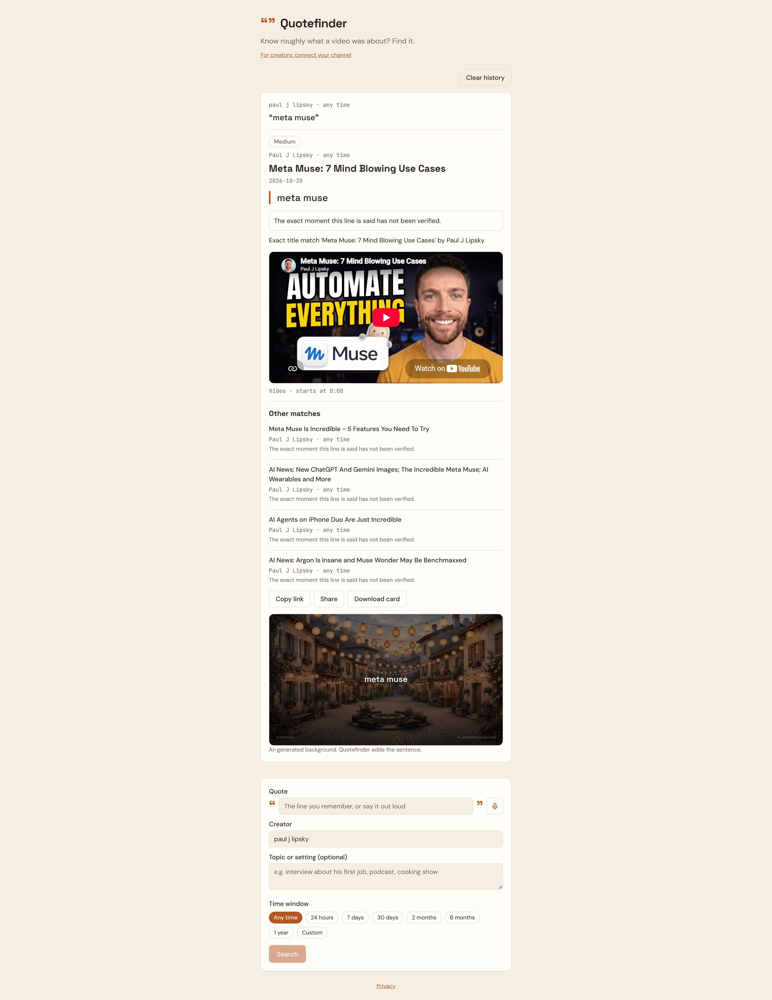
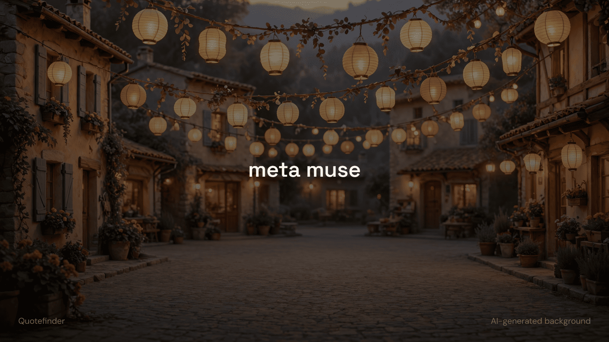
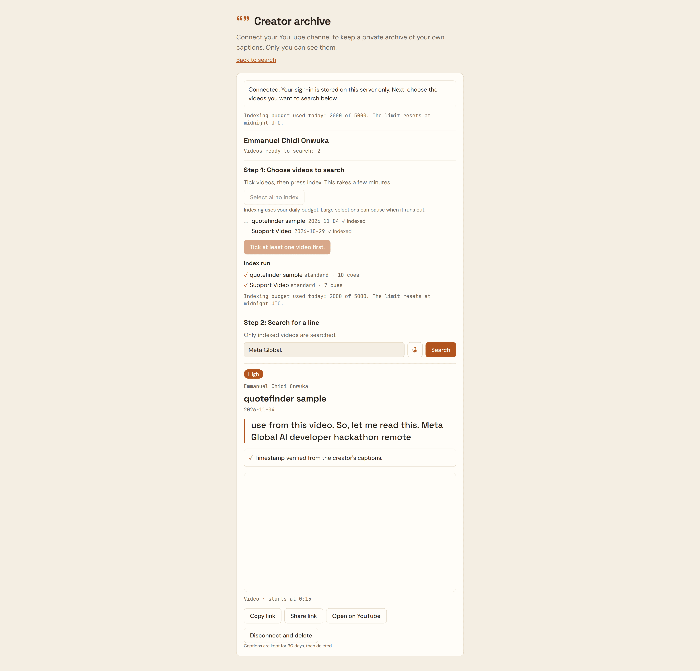

# Quotefinder

## The problem

You remember a line from a video but not the video itself. YouTube search
matches titles and descriptions, not what is said in the video, so a line
you half-remember is hard to find. Quotefinder searches titles and
descriptions through YouTube's official API. It uses Meta's models to turn
a fuzzy memory into search wordings and to rank the matches, and it shows
only links it has checked. Creators can also search the captions of their
own videos, to find the moment they said something. Caption text is shown
only to that creator.

Type or speak a line you remember from a video. Quotefinder searches the
creator's real YouTube uploads (or the wider YouTube catalogue when no creator
is given), matches the line against titles and descriptions, and returns the
matching video with an embedded player. Quote search matches titles and
descriptions and does not read transcripts, so its timestamps are not
verified. The creator archive reads captions only for the signed-in
creator's own videos, returns timestamps verified from those captions,
and shows caption text only to that creator.

Built for the **Build for Your World** hackathon. All work on this project,
including code, README, and spec, starts on Oct 27, 2026 and finishes by the
Nov 4 deadline.

## Screenshots

Quote search: a remembered line, the result card with the verification note,
and the other matches.



Share card: an AI-generated background, with the app drawing the exact
sentence on top.



Creator archive: a creator's own captions, searched, with the timestamp
verified from those captions. Only the signed-in creator can see this page.



## Run it yourself

What you need: Node.js (tested with version 24)
and two API keys: a Meta Model API key and a YouTube Data API key.

Where to get the keys: get a Meta Model API key from the Meta Model API
dashboard, and a YouTube Data API key from the Google Cloud Console with the
YouTube Data API v3 enabled. Keys go only in your local `.env` file. Do not
put keys in the README or commit them.

Steps:

```sh
git clone https://github.com/Emmanuel-Onwuka-dev/Quote_Finder.git
cd Quote_Finder
cp .env.example .env   # add MODEL_API_KEY and YOUTUBE_API_KEY to .env
npm install
```

Then run the server in one terminal and the client in another:

```sh
npm run dev:server     # API on :8787 (one terminal)
npm run dev:client     # UI with /api proxy (another terminal)
```

Open the address the client prints in your browser.

What works without extra setup: quote search, voice input (it uses the Meta
key), and share cards.

What needs more setup: the creator archive needs a Google OAuth client with a
matching redirect URI. Judges can skip it and still test quote search end to
end. The archive is for creators who sign in with their own channel so the app
can index their captions.

A hosted version is at https://quotefinder-emmanuelonwuka.duckdns.org. It runs
the same code. Quote search works there. The creator archive works only for
accounts added as test users.

## Platform policy

This version does not scrape any platform and does not download any video or
audio. It uses only official APIs (YouTube Data API v3), oEmbed, the YouTube
embedded player, and Meta's models. No transcript fetching, no scrapers, no
downloads.

Known risk (creator archive, spec section 13A): YouTube's policy text does not
clearly cover showing caption text from an authorized channel to other people.
Caption text is shown only to the signed-in creator who owns the channel, so
this version does not depend on that answer.

## Models and tools

**Used in the live app:**

- Muse Spark (`TEXT_MODEL`, default `muse-spark-1.3`): query variants,
  ranking, and answers from memory when nothing verifies. Endpoint:
  `POST {META_BASE_URL}/chat/completions`
- Muse Voice Transcribe (`TRANSCRIPTION_MODEL`, default
  `muse-voice-transcribe-1.0`): voice input. Endpoint:
  `POST {META_BASE_URL}/asr/transcribe`
- Muse Image (`IMAGE_MODEL`, default `muse-image-1.0`): share card
  backgrounds. Endpoint: `POST {META_BASE_URL}/images/generations`

**Optional, local only:**

- Muse Glimmer (`OPEN_MODEL_URL`, `OPEN_MODEL_NAME`): extra query wordings.
  Runs only on a local server you control. Off on the hosted version.

**Build tool** (not a runtime dependency):

- Coding agent: built with **Muse Code**.

## Original work (built during the hackathon)

- P0: Vite + React + TypeScript scaffold, Tailwind semantic tokens, fonts, SEO
  tags, server config, Meta API client stub, health endpoint.
- P1: YouTube engine (channel resolution, upload index, in-channel and
  everywhere search) with fuzzy title/description matching and unit tests.
- P2: `locateQuote` orchestrator: Muse query variants, shortlist-only
  ranking, memory fallback with verified links (oEmbed/HEAD), found
  thresholds, medium confidence cap, and time-window handling, with mocked
  unit tests.
- P3a: `POST /api/quote-stream`: zod body validation, `locateQuote`
  progress streamed as SSE stages, `result`/`error` events, with endpoint
  tests.
- P3b: chat UI: session-only turns, live SSE progress, result card
  (nocookie embed, unverified notice), candidate list, `openExternal`
  links, original SVG brand, SEO tags, and lib unit tests.
- A1: creator archive foundation: Google OAuth (PKCE) connect/disconnect
  for creators, encrypted refresh-token storage in SQLite, `/creator`
  page, and endpoint tests with mocked Google responses.
- A2: caption indexing pipeline: SRT parser, captions API client, daily
  budget counter, token refresh, videos/index routes, and creator
  indexing UI with live progress.
- A3: archive storage: videos/cues tables, purge of expired cue text,
  indexed states, real video counts, and transactional revoke-and-delete.
- A4: caption-window matching: 3-to-6-cue windows scored with the shared
  fuzzy overlap, ASR confidence cap, archive search endpoint with on-miss
  ASR refresh, listed-creators scope, and the verified-timestamp result.
- A5 (removed): viewer archive UI: creator picker on the search page,
  archive result card there, and miss/retry states. Removed when the archive
  went creator-only; caption text is shown only to the signed-in creator.
- P4: voice input: `POST /api/transcribe` (WAV validation, Meta ASR
  forward with 429/500 retries), `use-voice-input` hook (AudioWorklet
  capture, 16 kHz mono WAV), mic button with recording/transcribing
  states, and endpoint plus audio unit tests.
- P5: Glimmer variant integration: optional second-model rephrasings
  from `OPEN_MODEL_URL` appended to the Spark variants, never fatal.
  Glimmer takes one of the three search slots, with a 5-second timeout;
  the model name comes from OPEN_MODEL_NAME. Off on the hosted version:
  it needs a local Glimmer server reachable at OPEN_MODEL_URL.
- P5: Image quote cards: `POST /api/quote-card` renders a shareable
  card for each found result, shown in the result card, hidden on
  failure.
- P6: result card sharing: Share button (browser share sheet, copy
  fallback) on found results, Download card button, and share text
  marking the remembered line as not verified.
- P7: creator archive share link: video title and link only; caption
  text is never shared.
- P8: voice input errors: silent interim chunks, plain "We didn't hear
  any speech" message on stop, and start and final errors still shown.
- P9: fallback reliability: nullable and clock-string fields accepted
  from the model, empty or non-web URLs skipped before fetch.
- P10: server error logging with step names and redaction; Sentry
  alerts when SENTRY_DSN is set.
- P11: honest no-result when the search quota is spent and nothing
  verifies, plus plain-language notes.
- P12: quote-card daily cap of 500 per process, with the AI-generated
  label.
- P13: time window applied to in-channel search results as well as the
  uploads index, with a test. Muse Spark chat cap (1000 per UTC day per
  process), with a test.
- P14: one terminal line per Meta call (model, path, status, duration),
  with no host, query string, or key.
- P15: progress labels name the Meta model at each step.
- P16: runner-up matches show their own date. Selecting a runner-up
  shows that video's date, not the main video's.

## External services and libraries

- YouTube Data API v3, YouTube oEmbed, YouTube embedded player.
- Meta Model API (Muse Spark, Muse Voice Transcribe, Muse Image;
  optionally Muse Glimmer).
- React, Vite, Tailwind CSS, Hono, Zod, Vitest, tsx.

## Development

```sh
cp .env.example .env   # fill in real keys; never commit .env
npm install
npm run dev:server     # API on :8787 (one terminal)
npm run dev:client     # UI with /api proxy (another terminal)
npm run typecheck
npm test
```

Keys go in `.env` on your machine or the platform secret store. Never in chat,
source files, or the browser.

Heavy testing day? Raise the daily search quota for the server session
(default 3000 units, resets at UTC midnight):

```powershell
$env:SEARCH_BUDGET_UNITS="10000"   # same terminal, before npm run dev:server
```

Muse Spark chat calls have their own cap of 1000 per UTC day per server
process. When it is reached, search still runs on title and description
matches. If no match is found, the result says that the model limit is
reached.

Errors are logged to the server console with the step name. If
SENTRY_DSN is set, they are also sent to Sentry, with request bodies,
headers, cookies, query strings, and keys removed. Leave SENTRY_DSN
empty to turn this off.

## Known limitations

- Timestamps are estimates for quote search. Quote search
  matches titles and descriptions and does not read captions,
  so it cannot verify when a line is said.
- Lines that are spoken but not written in a title or
  description cannot be found by quote search.
- Answers from memory are estimates, not verified matches:
  when no video matches, the model suggests candidates. Each
  link is checked before it is shown, but the video can still
  be the wrong one.
- On the hosted site the archive is limited to test-user
  accounts; see Run it yourself.
- The creator archive covers only the signed-in creator's own
  videos, and caption text is shown only to that creator. No
  public page shows caption text.
- Captions are kept for 30 days, then deleted.
- The model call budgets are counted in memory, so each
  server process keeps its own count. A server restart resets
  them.
- Daily limits use these defaults: YouTube search 3000 units,
  creator indexing 5000 units, Muse Spark chat 1000 calls,
  voice transcription 2000 calls, share cards 500 calls. One
  quote search spends roughly 400 to 500 YouTube units, so the
  default covers about six to seven searches a day.
- Voice input accepts WAV recordings only, from 2 KB to
  32 MB, and up to 10 minutes long.
- Muse Glimmer adds extra search wordings, but only from a
  Glimmer server on your own machine. The hosted site leaves
  it off.

## Licence

This project is licensed under the MIT Licence. See [LICENSE](LICENSE).
